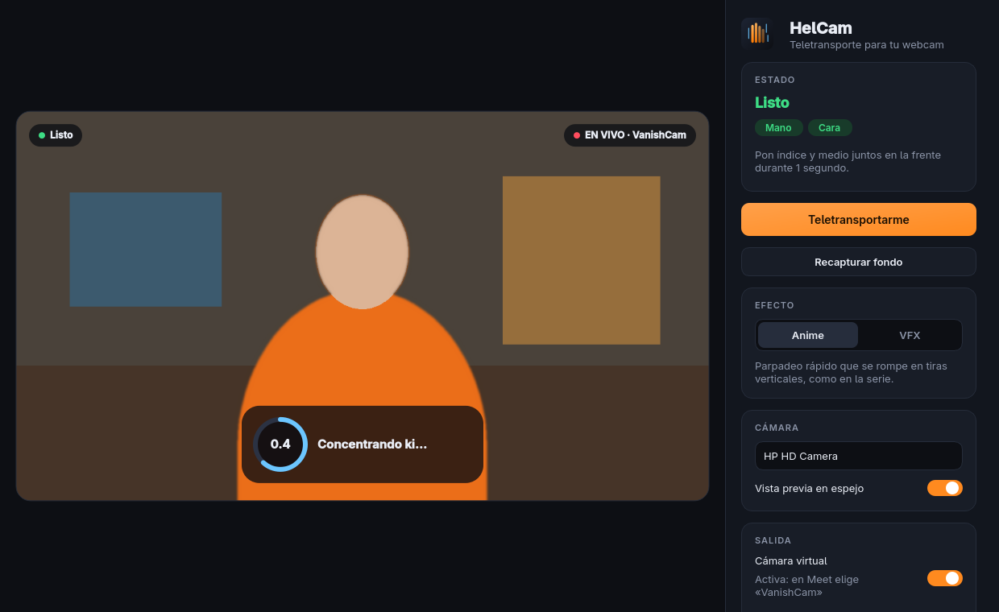
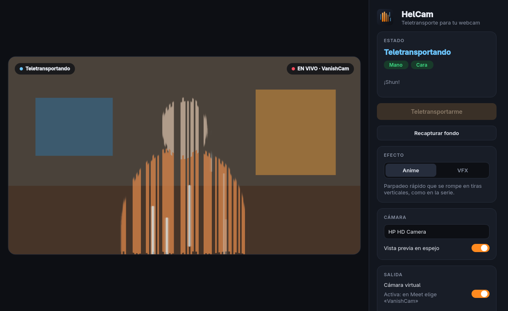

<p align="center">
  
</p>

<h1 align="center">HelCam</h1>

<p align="center">
  Teletransporte estilo anime para tu webcam: pon dos dedos en la frente y desapareces de la videollamada.
</p>

<p align="center">
  <a href="https://github.com/Nicovic17/vanish_webcam"></a>
  
  
  
</p>

<p align="center">
  
</p>

## Qué hace

- **Gesto de teletransporte:** índice y medio juntos sobre la frente durante 1 segundo. Desapareces; repite el gesto y regresas.
- **Dos estilos:**
  - **Anime** (por defecto): parpadeo rápido que se rompe en tiras verticales y un eco que se desvanece.
  - **VFX:** aura que crece mientras sostienes el gesto, separación RGB, línea de luz y onda expansiva.
- **Fondo automático:** sal del cuadro y el fondo se captura solo cuando no hay nadie. Si alguien entra mientras captura, vuelve a empezar.
- **Cámara virtual para Meet, Zoom o Discord:** a la llamada le llega el video limpio y derecho; los indicadores y el espejo solo los ves tú.
- **Sonido "shun"** sintético, o el tuyo propio.

<p align="center">
  
</p>

## Instalación (Linux)

Probado en Arch / Omarchy con Python 3.12. Necesitas [uv](https://docs.astral.sh/uv/).

```bash
git clone https://github.com/Helminth117/helcam.git
cd helcam
uv sync
./scripts/install-desktop.sh      # opcional: lo agrega al menú de aplicaciones
uv run helcam
```

La primera vez descarga los modelos oficiales de MediaPipe (unos 12 MB) en `~/.cache/helcam/models`.

### Cámara virtual

```bash
sudo pacman -S v4l2loopback-dkms v4l2loopback-utils
sudo modprobe v4l2loopback devices=1 video_nr=10 card_label=VanishCam exclusive_caps=1
```

Para que se cree sola en cada arranque:

```bash
echo v4l2loopback | sudo tee /etc/modules-load.d/v4l2loopback.conf
echo 'options v4l2loopback devices=1 video_nr=10 card_label=VanishCam exclusive_caps=1' | sudo tee /etc/modprobe.d/v4l2loopback.conf
```

Con la app abierta, en Meet ve a **Configuración → Video** y elige **VanishCam**. Solo una app a la vez puede mandar video a VanishCam.

## Uso

| Acción | Cómo |
|---|---|
| Desaparecer / regresar | Índice y medio juntos en la frente, 1 segundo. Para repetir, baja la mano primero. |
| Teletransportarte sin el gesto | Botón **Teletransportarme** o tecla `T` |
| Volver a capturar el fondo | Botón **Recapturar fondo** o `Espacio` |
| Pantalla completa | `F11` |
| Salir | `Ctrl+Q` |

Opciones de línea de comandos: `--camera N`, `--style anime|vfx`, `--no-virtual`. La app recuerda lo último que elegiste.

### Tu propio sonido

Pon un archivo `teleport.mp3`, `teleport.wav` o `teleport.ogg` en `~/.config/helcam/`. Si no hay ninguno, se usa un "shun" generado por código. Ese archivo vive fuera del repo a propósito: el audio del anime tiene derechos de autor y no se debe publicar.

## Cómo funciona

```
webcam ─► MediaPipe (manos + cara) ─► ¿dos dedos en la frente 1 s?
      └─► MediaPipe (silueta) ─► efecto sobre el fondo capturado ─► VanishCam ─► Meet
                                                                └─► vista previa (espejo + indicadores)
```

| Módulo | Qué hace |
|---|---|
| `helcam/gesture.py` | Geometría del gesto y temporizador de 1 segundo |
| `helcam/effects.py` | Efectos anime y VFX (OpenCV + NumPy) |
| `helcam/engine.py` | Máquina de estados: fondo automático, desaparecer, oculto, regresar |
| `helcam/vision.py` | Modelos de MediaPipe |
| `helcam/camera.py` | Webcams V4L2 (reconoce la infrarroja) y salida a v4l2loopback |
| `helcam/worker.py` | Hilo de video, para que la ventana nunca se trabe |
| `helcam/app.py` | Interfaz en PySide6 |

```bash
uv run pytest
```

**Notas técnicas:**
- `mediapipe` 1.x recibe `SIGKILL` al cargar modelos en esta configuración de Linux; por eso está fijado en 0.10.21.
- Se usa `opencv-contrib-python-headless`: el OpenCV normal trae su propio Qt 5, que choca con el Qt 6 de PySide6.

## Créditos

La idea de borrar a la persona de la webcam con un gesto viene de [**vanish_webcam**](https://github.com/Nicovic17/vanish_webcam) de **Nicovic17**. HelCam es una reescritura independiente: no comparte código con ese proyecto.

Proyecto de fans sin relación con Toei Animation ni Shueisha. *Dragon Ball* y sus personajes son marcas de sus dueños. Este repo no incluye imágenes ni audio del anime.

Licencia [MIT](LICENSE).
